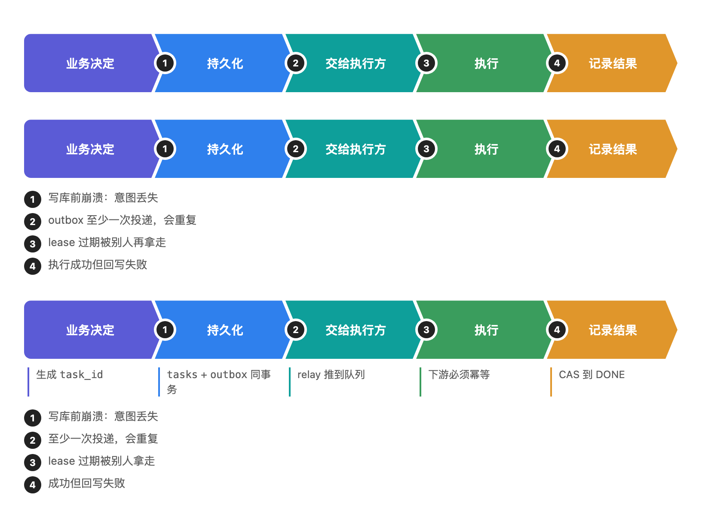
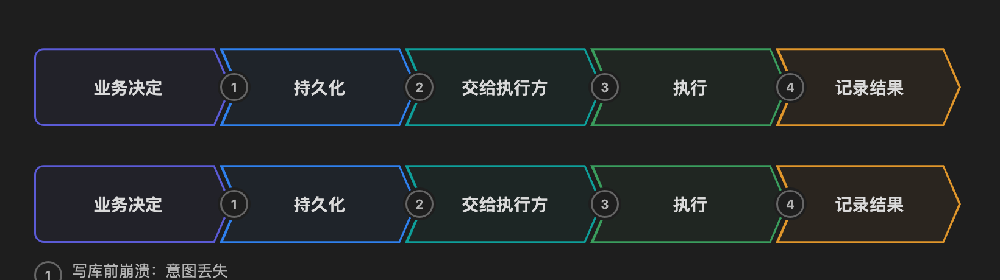

# Better Blocks

Code blocks for [Obsidian](https://obsidian.md) that render as diagrams you remember at a glance. No dependencies, a ~2.6 KB script, works in light and dark themes.

The first block is a **process flow**: each step is an outlined arrow in its own color, and every handoff between steps gets a numbered node. It is made for system design notes, where you sketch a lifecycle and mark every place work changes hands.



## Process flow

````markdown
```better-block-process-flow
业务决定 → 持久化 → 交给执行方 → 执行 → 记录结果
```
````

Or run **Better Blocks: Insert process flow** from the command palette; it inserts the block with `A → B → C` selected.

That's the whole thing. Three optional extras:

| Write | Get |
| --- | --- |
| `1. text` or `① text` | A note for handoff 1, listed under the arrows. |
| An indented line, or `- text`, under a step | A detail under that step's arrow. Put one step per line to use it. |
| `→ text` right under a step | A note for the handoff after that step. |

````markdown
```better-block-process-flow
业务决定 → 持久化 → 交给执行方 → 执行 → 记录结果
1. 写库前崩溃：意图丢失
2. outbox 至少一次投递，会重复
```
````

````markdown
```better-block-process-flow
业务决定
  生成 `task_id`
→ 写库前崩溃：意图丢失
持久化
  `tasks` + `outbox` 同事务
执行
```
````

Arrows can be `→`, `->` or `=>`. A line holding only circled numbers is ignored, so an ASCII sketch pastes in as it is. Inline `code` and `**bold**` work.



## Divider

A light, hand-numbered section mark for when you want to split text into 1, 2, 3 without making it a list: a serif number on a thin line that fades out.

````markdown
```better-block-divider
2 写库前崩溃
```
````

The first line is the number you choose (`1`, `2.1`, `B`, `三`), then an optional title. Right-click in the editor → **Better Blocks** to:

- **Wrap in divider**: turn the current line into a divider. A leading number is kept; otherwise it gets the next one.
- **Insert divider**: insert one numbered after the nearest divider above.

Both are also commands you can bind to a hotkey.

## Extra tools

Optional helpers that aren't code blocks. Each is off by default; turn it on in **Settings → Better Blocks**.

- **Reveal in file explorer button**: a button in each note's header that locates the note in the file explorer, like IntelliJ's "Select Opened File".

## Install

Until it is in the community plugin list, install with [BRAT](https://github.com/TfTHacker/obsidian42-brat): add `pujunru/better-blocks`. Or copy `main.js`, `manifest.json` and `styles.css` from the latest release into `.obsidian/plugins/better-blocks/`.

## Develop

```bash
npm install
npm run dev       # watch build
npm test
npm run preview   # writes dev/out/*.html: both themes, two widths, no Obsidian needed
```

## License

MIT
