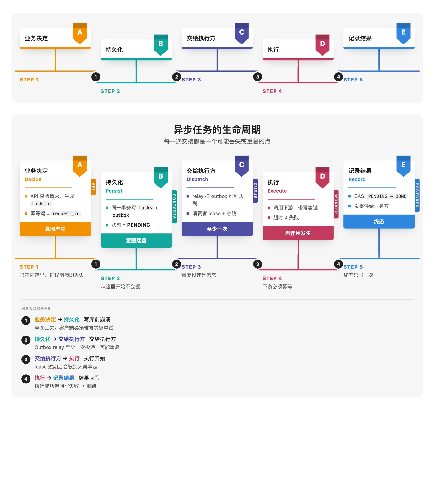
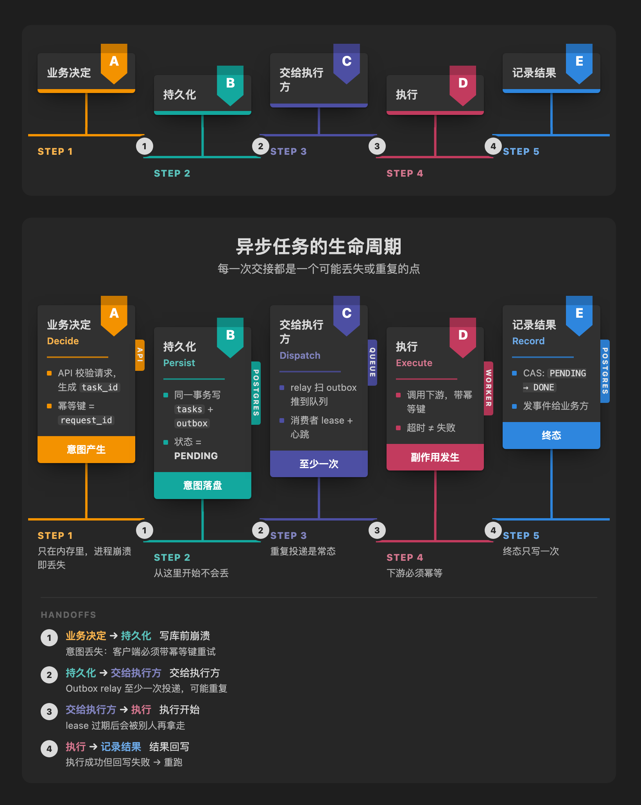

# Better Blocks

Code blocks for [Obsidian](https://obsidian.md) that render as clean, good-looking diagrams instead of generic flowcharts. Lightweight: one ~6 KB script, no dependencies, follows your light or dark theme.

The first block is a **process flow**: step cards on a stepped timeline, with numbered **handoff points** between steps. It was built for system design notes, where you draw a lifecycle and mark every place work changes hands.



## Process flow

### Quick: one line

````markdown
```better-block-process-flow
业务决定 → 持久化 → 交给执行方 → 执行 → 记录结果
```
````

Every arrow (`→`, `->` or `=>`) becomes a numbered handoff. A line holding only circled numbers (`① ② ③`) is ignored, so ASCII sketches paste in as they are. Write `Step | subtitle` to give a step a subtitle.

### Rich: one heading per step

````markdown
```better-block-process-flow
title: 异步任务的生命周期
subtitle: 每一次交接都是一个可能丢失或重复的点

## 业务决定 | Decide
- API 校验请求，生成 `task_id`
- 幂等键 = `request_id`
tag: API
foot: 意图产生
note: 只在内存里，进程崩溃即丢失

-> 写库前崩溃 | 意图丢失：客户端必须带幂等键重试

## 持久化 | Persist
- 同一事务写 `tasks` + `outbox`
- 状态 = **PENDING**
tag: Postgres
foot: 意图落盘
note: 从这里开始不会丢

-> 交给执行方 | Outbox relay 至少一次投递，可能重复

## 交给执行方 | Dispatch
- relay 扫 outbox 推到队列
- 消费者 lease + 心跳
tag: Queue
foot: 至少一次
note: 重复投递是常态

-> 执行开始 | lease 过期后会被别人再拿走

## 执行 | Execute
- 调用下游，带幂等键
- 超时 ≠ 失败
tag: Worker
foot: 副作用发生
note: 下游必须幂等

-> 结果回写 | 执行成功但回写失败 → 重跑

## 记录结果 | Record
- CAS: `PENDING → DONE`
- 发事件给业务方
tag: Postgres
foot: 终态
note: 终态只写一次
```
````



### Syntax

| Line | Where | Meaning |
| --- | --- | --- |
| `## Title \| subtitle` | anywhere | Starts a step. |
| `- text` | in a step | A bullet on the card. |
| `-> label \| detail` | between steps | A numbered handoff marker on the rail, listed under the diagram with its label and detail. In rich mode only declared handoffs are marked. |
| `tag: text` | in a step | A vertical tab on the card's side (owner, system). |
| `foot: text` | in a step | A colored footer bar on the card. |
| `note: text` | in a step | Text under the step's label on the timeline. |
| `color: name` | in a step | `orange`, `teal`, `indigo`, `crimson`, `blue`, `green`, `purple`, `coral`, or a hex color. |
| `badge: text` | in a step | Overrides the ribbon letter. |
| `title:` / `subtitle:` | before the first step | Diagram heading. |
| `badges: letters \| numbers \| none` | before the first step | Ribbon style (default `letters`). |
| `stagger: off` | before the first step | Keeps all cards and rails on one level. |

Inline `code` and `**bold**` work in any text. Wide flows scroll horizontally on narrow notes.

## Install

Until it is in the community plugin list, install with [BRAT](https://github.com/TfTHacker/obsidian42-brat): add `pujunru/better-blocks`. Or copy `main.js`, `manifest.json` and `styles.css` from the latest release into `.obsidian/plugins/better-blocks/`.

## Develop

```bash
npm install
npm run dev       # watch build
npm test
npm run preview   # writes dev/out/*.html: both themes, two widths, no Obsidian needed
```

## License

MIT
